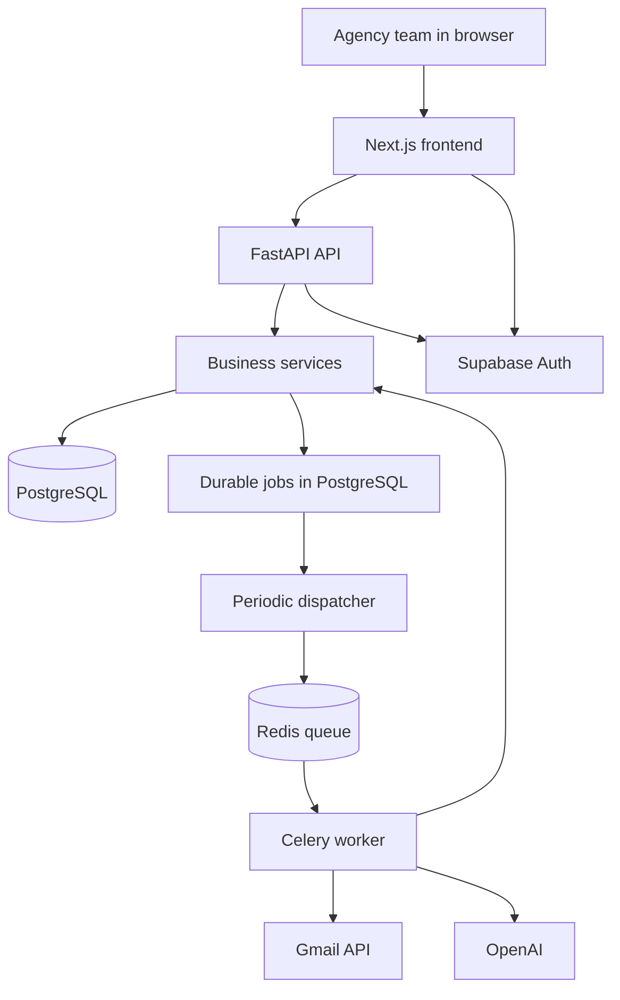

**Haan, detail mein samjhata hoon. Abhi project mein V0 + V1 + V2 implemented hain. V3 implement nahi kiya hai.** Pehle tumhari requirement V0-only thi; baad mein tumne V1/V2 instructions dekar “do it” bola, uske baad existing V0 ke upar woh functionality add hui.

Ek distinction pehle clear kar deta hoon: **code implemented aur local tests verified hain; real Gmail, Supabase aur OpenAI accounts ke saath live verification abhi pending hai**, kyunki actual credentials configured nahi hain.

Neeche explanation current repository aur code par based hai.

---

**1. Hum bana kya rahe hain?**

CreatorOps AI ek **creator agency ka financial operations application** hai.

Example samjho:

- Agency creators ke brand campaigns manage karti hai.
- Brand ko invoice issue hota hai.
- Finance team ko track karna hai ki kis invoice ka paisa aana baaki hai.
- Payment late ho toh relevant email conversation samajhni hai.
- Professional follow-up draft karna hai.
- Human ko draft approve karna hai.
- Approved email Gmail se bhejna hai.
- Har action ka record rakhna hai.
- Brand ke reply mein payment promise aaye toh usko track karna hai.
- Payment transaction record mile toh invoice se match karke outstanding balance update karna hai.

Isliye application ka central relationship yeh hai:

```text
Agency
  ├── Team members
  ├── Brands
  ├── Creators
  └── Campaigns
        └── Invoices
              ├── Collection tasks
              ├── Gmail conversations
              ├── Email analyses / payment promises
              ├── Payment allocations
              └── Audit history
```

**Campaign ka matlab yahan brand–creator engagement hai. Invoice us engagement ka financial receivable hai.**

---

**2. Original requirement aur ab tak ka scope**

| Version | Requirement | Kya implement hua |
|---|---|---|
| **V0** | Financial foundation aur approved AI follow-up | Auth, agencies, roles, brands, creators, campaigns, invoices, dashboard, overdue detection, Gmail connection, AI drafts, approval, sending, audit |
| **V1** | Collections workflow ko stronger banana | Due-soon/overdue stages, richer context, revision checks, approval validation, Gmail threading, recovery |
| **V2** | Incoming email understanding aur reconciliation | Email sync, classification, evidence checks, review queue, payment promises, manual transaction ingestion, matching, allocation, reversal |
| **V3** | Creator payouts aur actual payment execution | **Implement nahi hua** |

Do authoritative requirement files hain:

- [MASTER_CONTEXT.md](</Users/ashish/Desktop/brand deal /MASTER_CONTEXT.md>) — original V0 specification.
- [master_context_v1_v2.md](</Users/ashish/Desktop/brand deal /master_context_v1_v2.md>) — tumhare explicitly requested V1/V2 changes.

Original `master_contex.md` bhi preserve hai. V0 context ko overwrite karke V1/V2 requirements nahi ghusayi gayi hain.

---

**3. Kitne modules bane hain?**

Business responsibilities ke hisaab se group karein toh **12 main modules** samajh sakte ho. Yeh explanation ke liye grouping hai; har module alag server nahi hai.

| # | Module | Uska kaam |
|---|---|---|
| 1 | Authentication & workspace | Login/signup, agency banana, agency switch karna |
| 2 | Team permissions & tenant isolation | Kaun kya kar sakta hai; doosri agency ka data inaccessible rakhna |
| 3 | Brands | Client brands aur payment contact details |
| 4 | Creators | Agency ke creators ki information |
| 5 | Campaigns | Brand aur creator ke engagements |
| 6 | Invoices & balances | Invoice amounts, dates, status, paid/outstanding amounts |
| 7 | Dashboard | Financial overview aur attention-required information |
| 8 | Collections | Follow-up tasks, drafts, edits, approval, send workflow |
| 9 | Gmail integration | OAuth connection, relevant conversation reading, approved sending |
| 10 | Email intelligence | Replies classify karna, evidence, review, promises |
| 11 | Reconciliation | Transaction records ko invoices ke against allocate/reverse karna |
| 12 | Audit trail | Kisne kya kiya aur kab kiya uski permanent history |

Inke supporting engineering parts hain: background jobs, database migrations, testing, logging, configuration aur deployment.

---

**4. Problem ko aise breakdown kyun kiya?**

Requirement mein chaar alag tarah ki problems thi.

**Pehli: structured business data.**

Brand, creator, invoice, dates aur amounts predictable fields hain. Inko relational database aur normal application logic mein rakha.

**Doosri: financial correctness.**

Outstanding amount, eligibility, allocation aur invoice status ko deterministic Python rules se calculate kiya. Same inputs par same result milna chahiye.

**Teesri: unstructured communication.**

Email insaan natural language mein likhte hain:

> “Our finance team needs a PO before releasing payment.”

Yahan AI useful hai: email samajhna, classify karna aur professional wording banana.

**Chauthi: external actions aur failures.**

Gmail slow ho sakta hai, OpenAI unavailable ho sakta hai, worker restart ho sakta hai. Isliye long-running operations ko background jobs mein rakha aur approval/state database mein save ki.

Is breakdown se **money, AI interpretation aur external execution ki responsibility clear rehti hai.**

---

**5. Architecture kaise kaam karti hai?**

Humne **modular monolith** banaya hai.

Iska matlab: backend ek codebase hai, lekin andar responsibilities separate folders mein hain. API aur background worker isi backend code ko use karte hain.



Ismein:

- **Frontend:** screen aur interactions.
- **API:** requests accept karta hai, identity/permissions validate karta hai.
- **Services:** actual business rules.
- **PostgreSQL:** permanent records aur workflow state.
- **Redis:** jobs transport karne ki queue.
- **Celery:** background work execute karta hai.
- **Gmail/OpenAI:** external integrations.

**Redis financial source of truth nahi hai. PostgreSQL hai.**

---

**6. Kaunsi technology use hui aur kyun?**

| Technology | Kahan use hui | Kyun |
|---|---|---|
| **Next.js + React** | Frontend | Routes, layouts aur reusable interactive screens |
| **TypeScript** | Frontend contracts | API data aur component props ki type checking |
| **Tailwind CSS** | Styling | Consistent spacing, layout aur visual states |
| **Radix UI primitives** | Dialogs/buttons ki foundation | Accessible UI behavior; reusable shadcn-style components |
| **FastAPI** | Backend HTTP API | Python services ko typed API endpoints mein expose karna |
| **Pydantic** | Request/response aur AI schemas | Input validation aur structured contracts |
| **SQLAlchemy** | Database access | Models, queries, relationships, transactions aur locks |
| **Alembic** | Database migrations | Schema ko versioned steps mein safely evolve karna |
| **PostgreSQL** | Primary database | Transactions, constraints, exact numeric storage aur relational integrity |
| **Supabase Auth** | Identity/session | Password system khud build karne ki zarurat avoid karna |
| **Celery** | Background execution | Drafting, sending, polling aur classification |
| **Redis** | Celery broker | Background task transport |
| **OpenAI SDK** | AI integration | Structured draft/classification output |
| **LangGraph** | Draft generation workflow | Generation aur validation ka explicit flow |
| **Gmail API + OAuth** | Email integration | User-authorized mailbox read aur email send |
| **Fernet encryption** | Stored OAuth tokens | Tokens ko database mein plaintext se bachana |
| **Pytest** | Backend tests | Financial, security, AI aur workflow verification |
| **Playwright** | Browser E2E | Actual UI se complete workflows verify karna |
| **Docker Compose** | Local PostgreSQL/Redis | Repeatable local infrastructure |
| **Sentry / LangSmith** | Optional observability | Errors aur sanitized workflow traces |

Next.js mein webpack mode use hua kyunki host restrictions ke andar default build helper issue de raha tha. Framework/stack replace nahi kiya.

---

**7. Data model: database mein kya store hota hai?**

**Identity aur agency records:**

| Record | Meaning |
|---|---|
| `Agency` | Ek customer workspace |
| `User` | Application user identity |
| `Membership` | User kis agency mein kis role se belong karta hai |

Ek user multiple agencies ka member ho sakta hai. Isliye role directly user par nahi, membership par hai.

**Core business records:**

| Record | Meaning |
|---|---|
| `Brand` | Client aur payment contact |
| `Creator` | Creator details |
| `Campaign` | Brand–creator engagement |
| `Invoice` | Amount, currency, issue/due dates, status, references |

Creator ka payout percentage metadata ke roop mein ho sakta hai, **payout calculation/execution engine nahi bana hai**.

**Collections aur email records:**

| Record | Meaning |
|---|---|
| `CollectionTask` | Invoice ke particular follow-up stage ka workflow |
| `EmailThread` | Conversation grouping |
| `EmailMessage` | Individual email ka normalized content |
| `Integration` | Agency ka Gmail connection |
| `OAuthState` | Secure OAuth connection attempt |
| `AIAction` | Draft-generation attempt ki information |
| `Job` | Background operation ka durable intent |
| `AuditLog` | Recorded action history |

**V2 records:**

| Record | Meaning |
|---|---|
| `EmailSync` | Invoice ke Gmail sync ka checkpoint/status |
| `EmailAnalysis` | AI result, evidence, confidence aur review |
| `PaymentPromise` | Sender ka payment commitment |
| `PaymentTransaction` | Manually/mock imported payment record |
| `PaymentAllocation` | Transaction ka invoice par assigned amount |
| `ReconciliationDecision` | Human matching decision aur idempotency record |

`PaymentTransaction` aur `PaymentAllocation` separate isliye hain kyunki:

- Ek transaction multiple invoices mein split ho sakta hai.
- Ek invoice multiple partial payments se settle ho sakta hai.
- Allocation reverse ho sakta hai, original transaction record retain karte hue.

---

**8. Login se authorized request tak data flow**

Example: tum login karke invoice screen kholte ho.

1. Frontend Supabase se sign-in karta hai.
2. Supabase session/access token deta hai.
3. Frontend API request ke saath bhejta hai:

   ```text
   Authorization: Bearer <access-token>
   X-Agency-ID: <selected-agency>
   ```

4. Backend Supabase ke `/auth/v1/user` se session verify karta hai.
5. Email verification check hota hai.
6. Application user resolve/create hota hai.
7. Backend check karta hai: selected agency mein membership hai?
8. Mutation ho toh relevant permission bhi check hoti hai.
9. Uske baad agency-scoped database query chalti hai.

**Browser se agency ID bhej dena access grant nahi karta. Membership backend verify karta hai.**

Relevant code:

- [frontend/lib/auth.ts](</Users/ashish/Desktop/brand deal /frontend/lib/auth.ts>)
- [frontend/lib/api.ts](</Users/ashish/Desktop/brand deal /frontend/lib/api.ts>)
- [backend/app/core/security.py](</Users/ashish/Desktop/brand deal /backend/app/core/security.py>)

---

**9. Roles aur tenant isolation**

Permissions roughly aise divided hain:

| Action | Owner | Admin | Finance | Ops | Viewer |
|---|---|---|---|---|---|
| Read workspace data | ✓ | ✓ | ✓ | ✓ | ✓ |
| Manage brands/invoices | ✓ | ✓ | ✓ | — | — |
| Manage creators/campaigns | ✓ | ✓ | — | ✓ | — |
| Prepare drafts | ✓ | ✓ | ✓ | ✓ | — |
| Approve sending | ✓ | ✓ | ✓ | — | — |
| Review email analysis | ✓ | ✓ | ✓ | ✓ | — |
| Import transactions | ✓ | ✓ | — | — | — |
| Approve reconciliation | ✓ | ✓ | ✓ | — | — |
| Manage members/Gmail | ✓ | ✓ | — | — | — |

Ownership changes par extra owner-only safeguards hain.

**Tenant isolation** ka matlab Agency A ka user Agency B ka invoice access nahi kar sakta.

Protection layers:

- Request par membership validation.
- Business queries mein `agency_id` filter.
- Related records par tenant-safe foreign-key constraints.
- Unauthorized cross-agency references reject.
- Critical mutations mein current membership dobara validate.

Tenant repository: [backend/app/repositories/tenant.py](</Users/ashish/Desktop/brand deal /backend/app/repositories/tenant.py>).

Yeh application query scoping aur database constraints se implement hai; isko PostgreSQL RLS implementation kehna accurate nahi hoga.

---

**10. Invoice create hone par kya hota hai?**

Maan lo ₹1,00,000 ka invoice create karna hai.

```text
Invoice form
  → API client
  → FastAPI route
  → Pydantic validation
  → Permission check
  → Entity service
  → Database insert + audit
  → Response
  → Updated UI
```

Service validate karti hai:

- Amount valid aur positive hai?
- Supported decimal precision hai?
- Dates valid hain?
- Brand isi agency ka hai?
- Campaign reference valid hai?
- Campaign aur invoice ki relevant brand/currency details compatible hain?
- Invoice number agency ke andar duplicate toh nahi?

**Money representation:**

```text
Browser/API:  "100000.00" string
Python:       Decimal
PostgreSQL:   NUMERIC(18,2)
```

Browser floating-point arithmetic ko authoritative financial calculation nahi banaya.

Invoice status ke rules:

- Unissued invoice: `DRAFT`
- Due date future: `SENT`
- Due date today: `DUE`
- Due date passed: `OVERDUE`
- Settled: `PAID`
- Cancelled issued record: `VOID`

Agency timezone ke hisaab se “today” calculate hota hai.

Issued invoice ko casually delete karne ke bajaye financial history preserve ki jati hai.

---

**11. Main collections workflow: invoice se sent email tak**

Yahi original V0 ka central workflow hai.

**A. Task detection**

Scanner invoice dates aur outstanding balance dekhta hai.

Current stages:

- `DUE_SOON`
- `OVERDUE`
- `PROMISE_MISSED:<promise-id>`

Same invoice aur same stage ke duplicate tasks database uniqueness se prevent hote hain.

**B. Draft request**

User “Generate draft” karta hai.

Backend:

1. Role validate karta hai.
2. Task/invoice eligibility check karta hai.
3. Task ko `DRAFTING` mark karta hai.
4. PostgreSQL mein draft job save karta hai.
5. Worker ko background mein execute karne deta hai.

**C. Context collection**

Worker load karta hai:

- Invoice number, dates, amount.
- Current outstanding balance.
- Brand/contact.
- Campaign/payment terms.
- Recent collection history.
- Relevant Gmail conversation.
- Applicable payment promises.

**D. AI draft**

LangGraph ka drafting flow:

```text
Start → Generate → Validate → End
```

AI wording suggest karta hai. Amount, currency, due date aur recipient jaise facts trusted code se aate hain.

Structured result validate hone ke baad draft save hota hai.

**E. Human edit aur approval**

Draft revision number rakhta hai.

```text
Generated draft: revision 1
Human edit:     revision 2
Approval:       revision 2 ka exact snapshot
```

Approval mein exact content, recipient, sender, invoice/balance facts aur approver/time bind hote hain.

Isse stale draft approve/send karne ka risk control hota hai.

**F. Sending**

Worker send se pehle dobara validate karta hai:

- Approver ke paas abhi permission hai?
- Invoice/task eligible hai?
- Balance change toh nahi hua?
- Recipient/sender match karte hain?
- Approved revision valid hai?

Phir Gmail send hota hai aur message/thread IDs save hote hain.

Core files:

- [services/collections.py](</Users/ashish/Desktop/brand deal /backend/app/services/collections.py>)
- [services/collection_execution.py](</Users/ashish/Desktop/brand deal /backend/app/services/collection_execution.py>)
- [agents/collections/graph.py](</Users/ashish/Desktop/brand deal /backend/app/agents/collections/graph.py>)

---

**12. Gmail send ke waqt failure aaye toh?**

Yeh important reliability case hai.

Maan lo Gmail ne email accept kar li, lekin network connection toot gaya. Backend ko success response nahi mila.

Agar hum blindly retry karein toh duplicate follow-up ja sakta hai.

Isliye:

1. External send se pehle database mein `SENDING` state commit hoti hai.
2. Message ka deterministic identifier banta hai.
3. Send result unclear ho toh task `SEND_UNCERTAIN` hota hai.
4. Recovery Gmail Sent mail mein identifier search karti hai.
5. Confirmation mile toh sent record complete hota hai.
6. Confirmation na mile toh uncertainty visible rehti hai.

**Exactly-once Gmail delivery ka guarantee claim nahi kiya. Ambiguous result par automatic resend nahi hota.**

---

**13. Gmail connection kaise kaam karta hai?**

User Settings mein connect karta hai.

```text
Connect Gmail
  → Google consent page
  → OAuth callback
  → State/PKCE validation
  → Token exchange
  → Granted scopes check
  → Encrypted tokens save
```

Requested scopes reading aur sending ke liye hain.

Access/refresh tokens frontend ko return nahi kiye jate. Database mein encrypted store hote hain.

Relevant email matching mein brand contact aur invoice reference use hote hain. Exact invoice boundaries check hoti hain, taaki `INV-1` ko `INV-10` se confuse na karein.

Email normalization mein plain text prefer hota hai; HTML se text extract hota hai; scripts/styles aur unnecessary quoted content filter kiya jata hai. Attachment extraction implement nahi hai.

---

**14. V2 Email Intelligence ka flow**

Maan lo brand reply karta hai:

> “We will release payment on 25 October 2026.”

Flow:

```text
Periodic/manual sync
  → Relevant Gmail messages
  → Store/deduplicate messages
  → Queue classification
  → Structured AI output
  → Evidence validation
  → Accepted interpretation or human review
  → Source-linked payment promise
```

Classification categories:

- `PAYMENT_PROMISED`
- `PAYMENT_SENT`
- `DISPUTE`
- `PO_REQUIRED`
- `INFORMATION_REQUESTED`
- `PAYMENT_DELAYED`
- `OTHER`
- `UNCERTAIN`

Output mein classification, confidence, applicable extracted fields, summary aur source evidence hota hai.

Validation checks:

- Evidence quote source email mein actually present hai?
- Extracted reference source evidence mein hai?
- Amount evidence mein present hai?
- Explicit promised date evidence se verify ho rahi hai?
- Invoice/brand/currency conflict hai?
- Confidence threshold se kam hai?
- Date ambiguous hai?

Example:

> “Next Friday tak ho jayega.”

Isko blindly exact date mein convert nahi kiya jata. Review required ho sakta hai.

Original model output retain hota hai; human correction separate decision ke roop mein save hoti hai.

**“Payment sent” email ko actual receipt nahi maana jata. Usse invoice automatically PAID nahi hota.**

Agar accepted explicit promise date pass ho jaye aur amount outstanding ho, missed-promise task create ho sakta hai.

Sync incremental checkpoints, overlap aur message-ID uniqueness use karta hai. Yeh full mailbox backup/mirror nahi hai.

Core files:

- [services/email_sync.py](</Users/ashish/Desktop/brand deal /backend/app/services/email_sync.py>)
- [services/email_intelligence.py](</Users/ashish/Desktop/brand deal /backend/app/services/email_intelligence.py>)
- [agents/email_intelligence.py](</Users/ashish/Desktop/brand deal /backend/app/agents/email_intelligence.py>)

---

**15. Reconciliation ka flow**

Reconciliation ka matlab: **recorded payment ko correct invoice ke against account karna.**

Actual bank transfer application execute nahi karti.

Illustrative example:

```text
Invoice amount:        ₹1,00,000
Imported transaction:  ₹40,000
Approved allocation:   ₹40,000

Paid amount:           ₹40,000
Outstanding:           ₹60,000
```

Steps:

1. Owner/Admin manual transaction record add karta hai.
2. Duplicate identifiers/references check hote hain.
3. Deterministic matching engine candidates suggest karta hai.
4. Human evidence/warnings review karta hai.
5. Authorized user allocation approve karta hai.
6. Allocation, balance update aur audit transactionally save hote hain.

Matching mein use ho sakte hain:

- Explicit invoice ID/reference.
- Payment reference.
- Payer/brand identity.
- Currency.
- Amount aur date as supporting evidence.

**Sirf same amount hone par automatic match nahi hota.**

Supported cases:

- Exact payment.
- Partial payment.
- Multiple transactions against one invoice.
- Explicit split across invoices.
- Overpayment.
- Ambiguous match.
- Currency mismatch.
- Rejection.
- Allocation reversal.

Idempotency ka matlab: same approved request repeat ho toh double allocation na bane. Same key ke saath changed instructions aayein toh conflict reject ho.

Reversal original history delete nahi karti. Allocation reversed mark hota hai, reason/actor/time record hote hain aur balance recalculate hota hai.

Confirmed allocations wale invoice ke financial fields ko generic edit se override karna blocked hai.

Core files:

- [services/reconciliation.py](</Users/ashish/Desktop/brand deal /backend/app/services/reconciliation.py>)
- [services/balances.py](</Users/ashish/Desktop/brand deal /backend/app/services/balances.py>)

Manual/mock import ka record **bank-verified evidence hone ka claim nahi karta**.

---

**16. AI exactly kya karti hai?**

| Responsibility | AI | Deterministic code / human |
|---|---|---|
| Professional wording | ✓ | Human reviews |
| Email classification | ✓ | Schema/evidence checks |
| Suggested interpretation | ✓ | Human review when needed |
| Outstanding balance | — | Python + database |
| Invoice status | — | Business rules |
| Recipient selection | — | Trusted application data |
| Reconciliation approval | — | Authorized human |
| Send authorization | — | Human approval + backend |
| Actual payment movement | — | Implement nahi hai |

AI ko database mutation tools ya unrestricted financial actions nahi diye.

LangGraph human approval ka permanent storage nahi hai. **Human wait aur workflow state PostgreSQL mein persist hoti hai.**

---

**17. Folder structure aur har major source file ka purpose**

Root structure:

```text
brand deal/
├── backend/
├── frontend/
├── docs/
├── scripts/
├── .github/workflows/
├── compose.yaml
├── render.yaml
├── .env.example
├── README.md
├── CONTRIBUTING.md
├── MASTER_CONTEXT.md
├── master_contex.md
└── master_context_v1_v2.md
```

**Root files:**

| File | Responsibility |
|---|---|
| `README.md` | Setup, run commands, features, workflows, tests |
| `CONTRIBUTING.md` | Engineering conventions aur active scope |
| `.env.example` | Required setting names; actual secrets nahi |
| `.gitignore` | Secrets, generated files aur dependencies Git se exclude |
| `compose.yaml` | Local PostgreSQL/Redis services |
| `render.yaml` | Backend/worker deployment configuration |
| `.github/workflows/ci.yml` | Automated checks ka workflow |
| Context files | Product requirements aur scope |

**Backend layering:**

```text
backend/app/
├── main.py
├── core/
├── models/
├── schemas/
├── repositories/
├── services/
├── api/v1/
├── agents/
├── integrations/gmail/
├── workers/
├── tests/
└── seed.py
```

Ek feature ka normal path:

```text
API route → Schema → Service → Repository/Model → Database
```

Is layering ka purpose: HTTP handling, business rules aur database access ek giant file mein mix na hon.

**`backend/app/main.py`**

Application entry point:

- FastAPI app.
- Router registration.
- CORS.
- Request context.
- Standard error responses.
- Health/readiness endpoints.

**`backend/app/core/`**

| File | Purpose |
|---|---|
| `config.py` | Environment settings, defaults, production/test configuration validation |
| `database.py` | SQLAlchemy engine, session aur request DB lifecycle |
| `security.py` | Authentication, membership scope, RBAC, encryption |
| `errors.py` | Application error abstraction |
| `logging.py` | Structured application logging |
| `observability.py` | Optional Sentry/LangSmith setup aur redaction |

**`backend/app/models/`**

| File | Purpose |
|---|---|
| `entities.py` | V0/shared tables, relationships aur constraints |
| `operations.py` | V2 analysis/promise/transaction/allocation models |

Models describe karte hain **database mein kya valid record ho sakta hai**.

**`backend/app/schemas/`**

| File | Purpose |
|---|---|
| `contracts.py` | Core requests/responses aur drafting contracts |
| `operations.py` | V2 extraction, review aur reconciliation contracts |

Schemas describe karte hain **API/AI boundary par kya valid data accept hoga**.

**`backend/app/repositories/tenant.py`**

Reusable agency-scoped queries, record lookup, pagination aur optional locking.

Har entity ke liye almost-identical repository file banane ki jagah shared implementation use hui.

**`backend/app/services/`**

| File | Business responsibility |
|---|---|
| `workspace.py` | Agencies, memberships, ownership safeguards |
| `entities.py` | Brand/creator/campaign/invoice CRUD rules |
| `finance.py` | Date-based statuses, stages, dashboard calculations |
| `balances.py` | Confirmed paid amount, outstanding aur overpayment |
| `collections.py` | Draft/edit/approve/reject workflow transitions |
| `collection_execution.py` | Background drafting, sending aur send recovery |
| `email_sync.py` | Gmail ingestion, checkpoints aur sync jobs |
| `email_intelligence.py` | Classification lifecycle, reviews aur promises |
| `reconciliation.py` | Imports, matching, allocations, rejection, reversal |
| `audit.py` | Consistent audit event creation |

**Yahi folder business logic ka main centre hai.**

**`backend/app/api/v1/`**

| File | HTTP boundary |
|---|---|
| `workspace.py` | Workspace/member APIs |
| `entities.py` | Core CRUD APIs |
| `operations.py` | Dashboard, collection aur Gmail operations |
| `intelligence.py` | Email sync/analysis/review APIs |
| `reconciliation.py` | Transaction/allocation/reversal APIs |

Core CRUD routes mein reusable router factory hai, taaki same boilerplate chaar baar duplicate na ho.

**`backend/app/agents/`**

| File | Purpose |
|---|---|
| `collections/graph.py` | Draft model call, generation/validation graph |
| `email_intelligence.py` | Classification model call aur evidence validator |

**`backend/app/integrations/gmail/`**

| File | Purpose |
|---|---|
| `oauth.py` | Consent URL, secure callback, connection lifecycle |
| `client.py` | Gmail requests, refresh, search, thread fetch, send |
| `normalize.py` | Gmail content ko usable normalized text mein convert |

**`backend/app/workers/`**

| File | Purpose |
|---|---|
| `celery_app.py` | Broker, timeouts aur periodic schedule |
| `tasks.py` | Scan, poll, dispatch, job execution aur retries |

**`backend/app/seed.py`**

Repeatable demo dataset. Registered application user ki agency mein sample brands, creators, campaigns aur invoices populate karne ke liye.

**Backend support files:**

| File | Purpose |
|---|---|
| `requirements.txt` | Runtime dependency ranges |
| `requirements.lock.txt` | Pinned runtime dependencies |
| `requirements-dev.txt` | Development/test dependencies |
| `requirements-dev.lock.txt` | Pinned development dependencies |
| `pyproject.toml` | Pytest/Ruff configuration |
| `Dockerfile` | Non-root backend container |
| `.dockerignore` | Container build se unnecessary files exclude |
| `alembic.ini` | Migration tooling configuration |

---

**18. Database migrations ka breakdown**

`backend/alembic/` mein:

| File | Purpose |
|---|---|
| `env.py` | Alembic ko DB connection aur model metadata dena |
| `script.py.mako` | New migration template |
| `39f05e6ad89b_...py` | Initial V0 schema |
| `48c6a780fd22_...py` | Audit immutability trigger |
| `ff8cbac1385c_...py` | V1 stages aur V2 tables/fields |

Migrations isliye hain taaki existing data ke saath application upgrade ho sake. Har baar database reset karna required nahi hona chahiye.

V1/V2 upgrade mein:

- Existing tasks `OVERDUE` stage mein backfill hote hain.
- Existing invoices default non-reconciliation-managed rehte hain.
- Old manually marked `PAID` invoices ke liye fake transaction records create nahi hote.

Preserved-data upgrade check bhi kiya gaya hai.

---

**19. Frontend folders aur files**

```text
frontend/
├── app/
├── components/
│   └── ui/
├── lib/
├── tests/
└── configuration files
```

**`frontend/app/` routes:**

| File/path | Screen |
|---|---|
| `layout.tsx` | Root application layout |
| `page.tsx` | Entry route |
| `globals.css` | Shared styles |
| `login/page.tsx` | Sign in |
| `signup/page.tsx` | Sign up |
| `(workspace)/layout.tsx` | Protected workspace shell |
| `(workspace)/dashboard/page.tsx` | Financial overview |
| `(workspace)/brands/page.tsx` | Brands |
| `(workspace)/creators/page.tsx` | Creators |
| `(workspace)/campaigns/page.tsx` | Campaigns |
| `(workspace)/invoices/page.tsx` | Invoice list |
| `(workspace)/invoices/[id]/page.tsx` | Individual invoice |
| `(workspace)/collections/page.tsx` | Collection review/actions |
| `(workspace)/email-intelligence/page.tsx` | Email interpretation queue |
| `(workspace)/reconciliation/page.tsx` | Payment matching/review |
| `(workspace)/audit/page.tsx` | Audit records |
| `(workspace)/settings/page.tsx` | Workspace/team/Gmail settings |

`(workspace)` route group hai; URL mein yeh folder name nahi aata. `[id]` dynamic invoice route hai.

**`frontend/components/`:**

| File | Responsibility |
|---|---|
| `workspace.tsx` | Active agency context, navigation, workspace shell |
| `auth-form.tsx` | Login/signup interactions |
| `dashboard.tsx` | Dashboard presentation |
| `entities.tsx` | Shared core entity screens/forms |
| `related-records.tsx` | Related business records dikhana |
| `invoice-detail.tsx` | Invoice facts, balances aur histories |
| `collections.tsx` | Draft, edit, approve, send/recovery UI |
| `email-intelligence.tsx` | Analysis, evidence, review/reprocess |
| `reconciliation.tsx` | Transaction entry, proposals, allocations/reversals |
| `audit.tsx` | Audit display |
| `settings.tsx` | Team/workspace/integration controls |

Page files thin rakhi hain; reusable behavior components mein hai.

**`frontend/components/ui/`:**

- `button.tsx` — reusable buttons.
- `badge.tsx` — statuses.
- `dialog.tsx` — dialogs.

Full component-library catalog import nahi kiya; required primitives rakhe.

**`frontend/lib/`:**

| File | Purpose |
|---|---|
| `auth.ts` | Supabase client, token retrieval, sign-out |
| `api.ts` | Shared HTTP client, auth/agency headers, errors, pagination |
| `types.ts` | Shared TypeScript data shapes |
| `utils.ts` | UI utilities/formatting |

**Frontend configuration:**

| File | Purpose |
|---|---|
| `package.json` | Dependencies aur run scripts |
| `package-lock.json` | Exact dependency resolution |
| `tsconfig.json` | TypeScript |
| `next-env.d.ts` | Generated Next.js types |
| `next.config.ts` | Next configuration |
| `postcss.config.mjs` | CSS processing |
| `eslint.config.mjs` | Lint rules |
| `.prettierignore` | Formatter exclusions |
| `playwright.config.ts` | Browser test setup |
| `vercel.json` | Frontend hosting config |
| `.env.example` | Public frontend setting names |
| `AGENTS.md` / `CLAUDE.md` | Coding-agent guidance; runtime product logic nahi |

`node_modules`, `.next`, Python virtual environment aur caches generated/dependency folders hain. Yeh hamara business source code nahi hain.

---

**20. Background jobs ki zarurat kyun padi?**

AI generation aur Gmail calls ko user ki HTTP request ke andar wait karwana unreliable hota.

Current pattern:

```text
Business change + Job record
        ↓ same database transaction
PostgreSQL commit
        ↓
Dispatcher
        ↓
Redis
        ↓
Celery worker
        ↓
Saved result + Audit
```

Isko transactional outbox pattern kehte hain: operation ka intent durable database mein rehta hai.

Current default periodic work:

- Invoice/promise scanning: approximately 5 minutes.
- Email polling: default 5 minutes, configurable.
- Job dispatch: approximately 5 seconds.

Transient provider failures bounded retries le sakte hain. Invalid output/permanent failures forever retry nahi hote.

Worker interruption recovery bhi hai. Gmail send barrier cross hone ke baad retry ka behavior conservative rehta hai.

---

**21. Audit trail kaise maintain hoti hai?**

Examples:

- Invoice created/updated.
- Collection task created.
- Draft generated/edited.
- Approval/rejection.
- Send started/succeeded/uncertain.
- Analysis reviewed.
- Allocation confirmed/reversed.

Records mein action ke hisaab se actor, entity, timestamp aur relevant details hote hain.

PostgreSQL trigger audit rows ke normal update/delete ko block karta hai.

**Audit trail application history hai; console logs operational debugging ke liye hain. Dono alag responsibilities hain.**

Logs/tracing mein secrets aur raw sensitive payload exposure reduce karne ke liye redaction hai. Optional monitoring actual accounts configure hone ke baad live verify karni hogi.

---

**22. Tests kya cover karte hain?**

Last completed verification:

| Check | Result |
|---|---|
| Backend tests | **81 passed** |
| Playwright E2E | **3 passed** |
| Frontend typecheck/lint/format/build | Passed |
| Backend Ruff lint/format | Passed |
| Migration/schema drift checks | Passed |
| Preserved-data upgrade check | Passed |

Backend test files ka purpose:

| File | Coverage |
|---|---|
| `conftest.py` | Dedicated test DB, fixtures, identities/adapters |
| `test_auth.py` | Identity/session behavior |
| `test_security.py` | Tenant isolation aur permissions |
| `test_crud.py` | Core entities aur references |
| `test_finance.py` | Dates, amounts, statuses, dashboard |
| `test_collections.py` | Collection transitions |
| `test_ai.py` | Structured draft output/guardrails |
| `test_gmail.py` | OAuth/Gmail behavior |
| `test_audit.py` | Audit behavior/immutability |
| `test_approval_revocation.py` | Revoked approval permissions |
| `test_workflow_recovery.py` | Failure/retry/recovery |
| `test_email_intelligence.py` | Classification, evidence, promises |
| `test_reconciliation.py` | Matching, allocation, balances, reversal |
| `test_v2_permissions_and_edges.py` | V2 roles aur edge cases |
| `test_seed.py` | Repeatable demo data |

`frontend/tests/primary.spec.ts` ke three browser scenarios:

1. Core create → draft → edit → approve → simulated send → audit.
2. Unauthenticated route protection.
3. Email promise review → partial payment allocation → reversal → invoice history.

E2E mein UI/API/PostgreSQL/Redis/Celery real hain. **External provider calls test adapters use karti hain; real Gmail delivery/OpenAI quality test pass hone ka claim nahi hai.**

---

**23. Scripts aur documentation**

| File | Purpose |
|---|---|
| `scripts/e2e_server.py` | Browser tests ke supporting processes/setup |
| `scripts/check_sources.py` | Context preservation aur config validation |
| `scripts/check_upgrade.py` | V0 data preserve karke V1/V2 migration verify |
| `docs/architecture.md` | Architecture decisions |
| `docs/acceptance.md` | Historical V0 acceptance evidence |
| `docs/deployment.md` | Hosting/configuration procedure |
| `docs/v1-v2-implementation.md` | Current implementation, checks aur limitations |

Main reading entry points:

- [README.md](</Users/ashish/Desktop/brand deal /README.md>)
- [Architecture](</Users/ashish/Desktop/brand deal /docs/architecture.md>)
- [V1/V2 implementation report](</Users/ashish/Desktop/brand deal /docs/v1-v2-implementation.md>)

---

**24. Deployment aur real-world readiness ki actual position**

Deployment architecture prepared hai:

```text
Next.js frontend → Vercel

FastAPI backend  → Render
Celery worker    → Render
PostgreSQL       → configured database service
Redis            → configured broker
```

Local development mein Docker Compose PostgreSQL/Redis provide karta hai.

Abhi:

- Public deployment nahi kiya.
- Remote GitHub Actions run verify nahi hua.
- Real Supabase signup/email confirmation pending.
- Real Google OAuth/token refresh/mailbox delivery pending.
- Real OpenAI output quality evaluation pending.
- Monitoring accounts ki live verification pending.
- Commit/push nahi kiya.
- Real mailbox access ya real email send nahi hua.

Isliye accurate status hai: **implemented, locally verified application with deployment configuration; live production integrations ka verification abhi baaki hai.**

---

**25. Kya deliberately nahi banaya?**

Scope ke bahar rehne wali cheezein:

- Creator payout calculations/approvals.
- Bank transfers.
- Stripe/Razorpay/payment gateway.
- Actual payment processing.
- Automatic bank verification.
- Automatic email sending without human approval.
- Automatic payment reconciliation.
- Currency conversion.
- CSV import — optional tha, implement nahi hua.
- Email attachment extraction.
- Gmail push infrastructure.
- Vector database/RAG.
- Kubernetes/Kafka/Temporal.
- Separate microservice per module.

**Ab jo application bani hai uska practical loop hai: agency data manage karo → invoices track karo → collection context samjho → AI draft review/approve karo → Gmail send karo → replies/promises review karo → manually recorded payments reconcile karo → poori history inspect karo.**


**Dashboard se pehle jo agency name, currency aur timezone wali screen aayi thi, woh “Create your agency workspace” onboarding screen hai.** Screenshot mein ab `spexora` workspace aur `owner` role dikh raha hai—workspace create ho chuka hai aur dashboard load ho raha hai.

**1. Workspace screen kyun zaroori hai?**

Login se application ko pata chalta hai **tum kaun ho**. Workspace se pata chalta hai **tum kis agency ka data manage kar rahe ho**.

```text
User: Ashish
   └── Membership: OWNER
          └── Agency: spexora
                 ├── Brands
                 ├── Creators
                 ├── Campaigns
                 └── Invoices
```

Ek user multiple agencies ka member ho sakta hai. Agency ke andar hi invoices, permissions aur financial records belong karte hain.

Isliye flow:

```text
Login
  → User verify
  → User ki agencies load
      ├── Agency nahi → Create workspace form
      └── Agency hai → Selected agency ka dashboard
```

**Yeh separate URL/page nahi hai.** `/dashboard` URL par shared `Workspace` component condition ke according onboarding form ya dashboard dikhata hai.

Code: [frontend/components/workspace.tsx:163](</Users/ashish/Desktop/brand deal /frontend/components/workspace.tsx:163>)

```tsx
if (!agency)
  return (
    // Create your agency workspace
    <WorkspaceForm done={reload} />
  );
```

Agar tum sirf briefly dikhne wali **“Loading workspace…”** screen ki baat kar rahe ho, woh session/agencies load hone tak ka loading state hai.

**2. Workspace submit karne par kya hua tha?**

[WorkspaceForm](</Users/ashish/Desktop/brand deal /frontend/components/workspace.tsx:48>) form submit karta hai:

```tsx
await api("/agencies", {
  method: "POST",
  body: Object.fromEntries(form),
});
```

Backend mein path:

```text
POST /api/v1/agencies
  → api/v1/workspace.py: create()
  → services/workspace.py: create_agency()
  → Agency + Membership + AuditLog
  → PostgreSQL commit
```

[create_agency()](</Users/ashish/Desktop/brand deal /backend/app/services/workspace.py:40>) yeh karta hai:

```python
agency = Agency(...)
db.add(agency)
db.flush()

db.add(Membership(
    agency_id=agency.id,
    user_id=user.id,
    role="OWNER",
))

audit(...)
db.commit()
```

Matlab ek agency bani, tum uske owner bane aur audit event save hua.

Frontend returned agency ID ko `localStorage` mein selection ke liye rakhta hai, phir agencies reload karta hai. **Actual agency record database mein hai; localStorage mein sirf selected agency ID hai.**

---

**3. Ab code tracing kaise start karo?**

**Aaj ek hi question trace karo: “Login ke baad dashboard kaise load hota hai?”** Saare folders ek saath padhne ki zarurat nahi.

Do cheezein side-by-side rakho:

- VS Code mein source files.
- Browser DevTools → **Network → Fetch/XHR**.

Consistently **`http://localhost:3000`** use karo.

**Step A — Browser mein actual requests dekho**

Dashboard reload karo. In requests ko identify karo:

```text
GET /api/v1/auth/me
GET /api/v1/agencies
GET /api/v1/dashboard/summary
GET /api/v1/brands
```

Har request par dekho:

- **Headers:** request URL, method, status.
- **Payload:** GET mein normally body nahi hogi.
- **Response:** backend ne kya data diya?
- **Initiator:** kis frontend call se request aayi?

Authorization token ko copy/share mat karna.

**Step B — Page ka entry point kholo**

[frontend/app/(workspace)/dashboard/page.tsx](</Users/ashish/Desktop/brand deal /frontend/app/(workspace)/dashboard/page.tsx>)

```tsx
export default function Page() {
  return <Dashboard />;
}
```

Yeh file route ko component se connect karti hai. Business calculations yahan nahi hain.

Phir parent [workspace layout](</Users/ashish/Desktop/brand deal /frontend/app/(workspace)/layout.tsx>) kholo:

```tsx
return <Workspace>{children}</Workspace>;
```

Samjho: dashboard render hone se pehle shared workspace wrapper ready hona chahiye.

**Step C — Authentication aur agency loading trace karo**

[frontend/components/workspace.tsx:127](</Users/ashish/Desktop/brand deal /frontend/components/workspace.tsx:127>) mein `reload()` padho:

```tsx
await api("/auth/me");
const { data } = await api<Agency[]>("/agencies");
```

Is function mein teen outcomes identify karo:

1. Unauthorized → login redirect.
2. Valid user, agency missing → onboarding.
3. Valid user, agency available → workspace/dashboard.

Phir `Context.Provider` dekho. Wahi selected agency child components ko provide karta hai.

**Step D — Shared API client dekho**

[frontend/lib/api.ts](</Users/ashish/Desktop/brand deal /frontend/lib/api.ts>)

Yahan trace karo:

```text
token()
  → Authorization header
  → Optional X-Agency-ID header
  → fetch()
  → Response parsing
  → Error or data
```

Token ka source [frontend/lib/auth.ts](</Users/ashish/Desktop/brand deal /frontend/lib/auth.ts>) hai.

**Step E — Dashboard ki data request dekho**

[frontend/components/dashboard.tsx](</Users/ashish/Desktop/brand deal /frontend/components/dashboard.tsx>)

```tsx
const { agency } = useWorkspace();
```

Yahan selected agency shared context se milti hai.

Phir:

```tsx
Promise.all([
  api("/dashboard/summary", { agency: agency.id }),
  allRecords("/brands", agency.id),
]);
```

Dono requests independent hain, isliye parallel load hoti hain.

Response milne par:

```tsx
setData(summary.data);
setBrands(brands.data);
```

React state update hoti hai aur UI dobara render hoti hai.

Screenshot mein empty message is condition se aata hai:

```tsx
data.totals.length === 0
```

Isliye abhi “Your financial overview starts here” dikh raha hai—financial records abhi nahi hain.

**Step F — Backend endpoint tak jao**

[backend/app/api/v1/operations.py:46](</Users/ashish/Desktop/brand deal /backend/app/api/v1/operations.py:46>)

`/dashboard/summary` route locate karo. Woh selected agency ke liye `dashboard()` service call karta hai.

Authentication/agency access ke dependencies [core/security.py](</Users/ashish/Desktop/brand deal /backend/app/core/security.py>) mein trace karo:

```text
identity()
  → Supabase token verification

current_user()
  → Application user resolve

scope()
  → X-Agency-ID + membership verification
```

**Step G — Actual calculations padho**

[backend/app/services/finance.py:120](</Users/ashish/Desktop/brand deal /backend/app/services/finance.py:120>) mein `dashboard()` kholo.

Ab questions ke answers code se nikalo:

- Invoices kis agency ke filter se load hoti hain?
- Outstanding kaise calculate hota hai?
- Overdue date kaise decide hoti hai?
- Totals currencies ke according separate kaise hain?
- Return JSON ka structure kya hai?

Balances ke liye `services/balances.py`, queries ke liye `repositories/tenant.py` aur table structure ke liye `models/entities.py` kholo.

Tumhara complete trace:

```text
/dashboard
  → Shared Workspace layout
  → Session + agency loading
  → Dashboard component
  → API client + token + agency header
  → FastAPI route
  → Auth/membership dependencies
  → Finance service
  → PostgreSQL queries
  → JSON response
  → React state update
  → Dashboard display
```

**4. Trace karte waqt notes kaise banao?**

Har important function ke liye bas yeh likho:

```text
Function:
Kisne call kiya:
Input:
Validation/permission:
Database read/write:
Output:
Failure par kya hota hai:
```

Aaj ka target: **upar wala dashboard flow apne words mein explain kar pao.** Uske baad ek brand create karke `POST /brands` trace karo; phir invoice creation. AI/Celery workflow tab uthana jab normal request → database → response connection clear ho jaye.


**Short answer: nahi—ek email/user multiple agencies ka member ya owner ho sakta hai.** Current UI first agency banwati hai; additional agency creation backend API support karti hai. Ek agency mein multiple users bhi ho sakte hain.

Ab tracing ko simple karte hain. **Abhi sirf login ka flow trace karo. Signup, dashboard aur database sab ek saath mat pakdo.**

**1. “Entry point” ek nahi—teen alag boundaries hain**

| Boundary | Entry point |
|---|---|
| Browser `/login` route | `frontend/app/login/page.tsx` |
| Login form submit | `frontend/components/auth-form.tsx` ka `submit()` |
| Hamara backend | `backend/app/main.py` |

**Important:** login credentials pehle hamare FastAPI backend par nahi jaate. Frontend Supabase ko directly login request bhejta hai. Login ke baad FastAPI token verify karke business data deta hai.

```text
Login form → Supabase Auth → Session/token
                                  ↓
Dashboard → FastAPI → PostgreSQL → Business data
```

Yeh distinction clear hote hi code ka connection samajhna easier hoga.

**2. Pehli file: login page**

Open: [frontend/app/login/page.tsx](</Users/ashish/Desktop/brand deal /frontend/app/login/page.tsx>)

Ismein `AuthForm` component render hota hai.

Isko aise samjho:

> URL `/login` hai, toh Next.js yeh page file select karta hai. Page actual form ka kaam `AuthForm` ko deta hai.

VS Code mein `AuthForm` par **Cmd+click** karo—component definition khul jayegi.

**3. Doosri file: actual form aur submit function**

Open: [frontend/components/auth-form.tsx](</Users/ashish/Desktop/brand deal /frontend/components/auth-form.tsx>)

Pehle neeche form dekho:

```tsx
<form onSubmit={submit}>
```

Meaning:

> User form submit karega toh `submit()` function chalega.

Ab upar `submit()` padho:

```tsx
event.preventDefault();
```

Normal browser form submission/page reload rokta hai.

```tsx
const form = new FormData(event.currentTarget);
```

Form se entered values collect karta hai.

```tsx
const credentials = {
  email: String(form.get("email")),
  password: String(form.get("password")),
};
```

Email/password object banata hai.

Phir main decision:

```tsx
const result = signup
  ? await auth().auth.signUp(...)
  : await auth().auth.signInWithPassword(credentials);
```

- `signup=true` → registration.
- `signup=false` → login.
- `/login` page default login mode use karta hai.
- `/signup` page same component signup mode mein use karta hai.

**Ek component reuse ho raha hai; do independent authentication implementations nahi hain.**

**4. Teesri file: `auth()` kya return karta hai?**

Open: [frontend/lib/auth.ts](</Users/ashish/Desktop/brand deal /frontend/lib/auth.ts>)

```ts
export function auth() {
  const url = process.env.NEXT_PUBLIC_SUPABASE_URL;
  const key = process.env.NEXT_PUBLIC_SUPABASE_PUBLISHABLE_KEY;

  if (!url || !key)
    throw new Error("Configure Supabase Auth to sign in.");

  client ??= createClient(url, key);
  return client;
}
```

Iska purpose:

1. Supabase settings read karo.
2. Supabase client create/reuse karo.
3. Client return karo.

Isliye:

```tsx
auth().auth.signInWithPassword(credentials)
```

ka practical meaning hai:

> Configured Supabase project se email/password login karwao.

**Password check hamari Python file nahi karti—Supabase Auth karti hai.**

**5. Login success ke baad kya hota hai?**

Wapas `auth-form.tsx`:

```tsx
if (result.error) throw result.error;
```

Error hai toh catch block UI mein message dikhata hai.

Success par:

```tsx
router.push("/dashboard");
```

Browser dashboard route par navigate karta hai.

Signup mein session absent ho toh confirmation message dikhta hai—yeh wahi branch hai jiske misleading wording ke baare mein humne discuss kiya tha.

Yahan tak tumhara first trace complete:

```text
/login page
  → AuthForm
  → Form submit
  → credentials
  → Supabase client
  → signInWithPassword()
  → success/error
  → /dashboard
```

**6. Ab dashboard par second flow start hota hai**

Open: [frontend/app/(workspace)/layout.tsx](</Users/ashish/Desktop/brand deal /frontend/app/(workspace)/layout.tsx>)

```tsx
return <Workspace>{children}</Workspace>;
```

Dashboard shared `Workspace` wrapper ke andar hai.

Next file: [frontend/components/workspace.tsx:127](</Users/ashish/Desktop/brand deal /frontend/components/workspace.tsx:127>)

`reload()` mein:

```tsx
await api("/auth/me");
const { data } = await api("/agencies");
```

Yahan **pehli baar is walkthrough mein hamara FastAPI backend involve hota hai**.

**7. `api()` request kaise bhejta hai?**

Open: [frontend/lib/api.ts](</Users/ashish/Desktop/brand deal /frontend/lib/api.ts>)

```ts
const accessToken = await token();
```

`token()` wapas `lib/auth.ts` mein hai:

```ts
const { data, error } = await auth().auth.getSession();
return data.session?.access_token;
```

Supabase session se access token leta hai.

Phir API client:

```ts
fetch(`${API_URL}/api/v1${path}`, {
  headers: {
    Authorization: `Bearer ${accessToken}`,
  },
});
```

`path="/auth/me"` ho toh actual request:

```text
GET http://localhost:8000/api/v1/auth/me
```

**8. Backend mein request kahan enter hoti hai?**

Open: [backend/app/main.py](</Users/ashish/Desktop/brand deal /backend/app/main.py>)

Yahan FastAPI app aur router registration hai:

```python
app.include_router(workspace.router, prefix="/api/v1")
```

Ab open: [backend/app/api/v1/workspace.py](</Users/ashish/Desktop/brand deal /backend/app/api/v1/workspace.py>)

```python
@router.get("/auth/me")
def me(user: User = Depends(current_user)):
    return {"data": user}
```

Combine karo:

```text
Prefix: /api/v1
Route:  /auth/me
Final:  /api/v1/auth/me
```

**9. `Depends(current_user)` ko skip mat karna**

FastAPI tumhe aata hai, toh yahan se familiar territory hai.

Open: [backend/app/core/security.py](</Users/ashish/Desktop/brand deal /backend/app/core/security.py>)

Dependency chain:

```text
/auth/me
  → current_user()
      → identity()
```

Execution samajhne ke liye andar se padho:

1. `identity()` bearer token leta hai aur Supabase se verify karta hai.
2. `current_user()` verified identity ko application `User` record se connect karta hai.
3. `me()` user response return karta hai.

**Supabase identity aur application user do related records hain.** Supabase credentials/session manage karta hai; application user memberships aur audit actors ke liye use hota hai.

**10. Phir agency screen ya dashboard decide hota hai**

`Workspace.reload()` next `/agencies` call karta hai.

Backend:

```text
api/v1/workspace.py: agencies()
  → services/workspace.py: list_agencies()
  → Agency JOIN Membership
  → Sirf current user ki agencies
```

Frontend response dekhkar:

```text
Unauthorized → /login
No agency    → Create workspace form
Agency found → Dashboard
```

**11. Browser aur debugger se practically kaise dekho?**

Pehle **breakpoints ke bina Network tab**:

1. http://localhost:3000/login kholo.
2. DevTools → Network → Fetch/XHR.
3. List clear karo.
4. Login karo.
5. Request order observe karo:
   - Supabase login request.
   - Hamara `/api/v1/auth/me`.
   - Hamara `/api/v1/agencies`.
   - Dashboard summary/brands requests.

Har request mein **URL, status aur response structure** dekho. Password/token ki screenshots share mat karna.

Phir **frontend breakpoint**:

1. DevTools → Sources.
2. `Cmd+P` → `auth-form.tsx` search karo.
3. `const credentials = ...` ya login call par breakpoint lagao.
4. Form submit karo.
5. **Step over** se next statements dekho.
6. **Call Stack** se dekho current function kis path se aaya.

Backend debugging ke liye VS Code debugger se FastAPI launch/attach karna hoga; normal terminal mein chal raha Uvicorn automatically editor breakpoints par stop nahi hoga.

**12. Aaj sirf yeh six boxes khud explain karo**

```text
1. /login page kis component ko render karta hai?
2. Submit button se kaunsa function chalta hai?
3. Password verify kaun karta hai?
4. Login ke baad session/token kahan se milta hai?
5. /auth/me backend par token verify kaise karta hai?
6. Agency missing ho toh form kaun dikhata hai?
```

Files ka reading order:

```text
app/login/page.tsx
  → components/auth-form.tsx
  → lib/auth.ts
  → components/workspace.tsx
  → lib/api.ts
  → backend/app/main.py
  → backend/app/api/v1/workspace.py
  → backend/app/core/security.py
  → backend/app/services/workspace.py
```

**Har file complete padhne ke bajaye, pehle sirf connected functions padho.** Ek notebook mein arrows aur inputs/outputs likho. Aaj login → workspace flow clear karo; uske baad invoice creation ka trace karna.